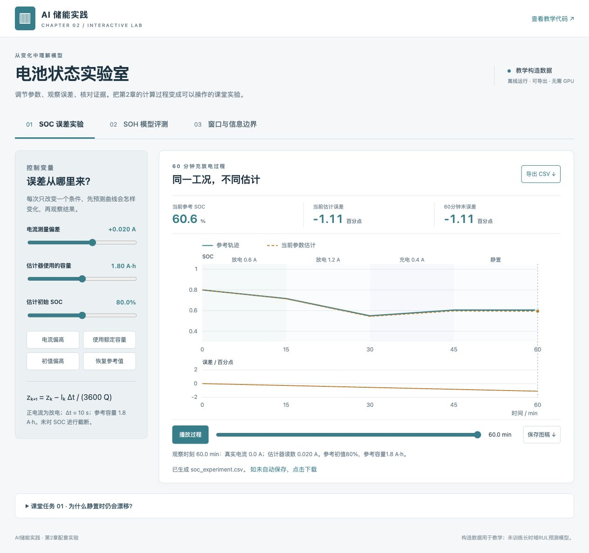
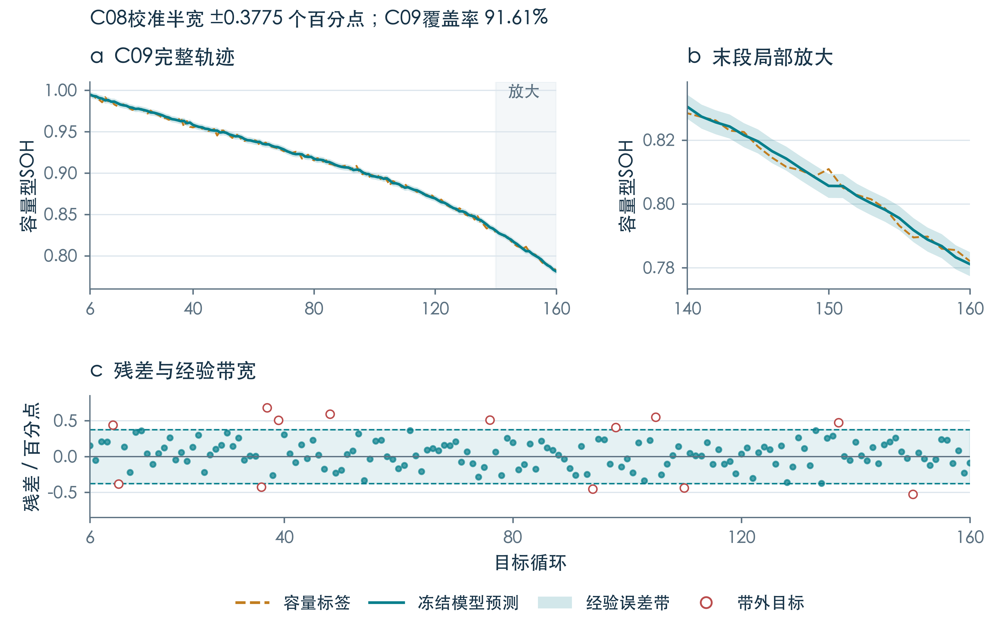

# AI储能实践 · 电池状态实验室

《储能系统人工智能实践》第2章配套教学代码。用可操作的SOC实验、冻结模型的SOH评测和可展开的历史窗口，理解参数误差、评价协议与信息边界。

**数据全部为教学构造数据；没有实测性能结论。** 本版本不训练长时域RUL预测模型。



## 先体验课堂演示

1. 在本页 **Code → Download ZIP** 下载并解压。
2. 双击 `demo/教学演示.html`，用浏览器打开。文件自带全部数据和脚本，无需安装Python、联网或启动服务。
3. 选择“电流偏高”“使用额定容量”“初值偏高”，播放充放电过程，观察误差并导出CSV或SVG。
4. 切换四个测试电芯、四种方法，放大末段；再到“窗口与信息边界”逐步揭示下一循环标签。

GitHub文件预览不会执行HTML，需先下载。开发时也可在仓库根目录运行 `python -m http.server 8000 --directory demo` 后访问 `http://localhost:8000`。

## 复现计算

建议 Python 3.12。macOS/Linux：

```sh
python3.12 -m venv .venv
source .venv/bin/activate
python -m pip install -r requirements.txt
python chapters/ch02/run.py --out results/run_001
python chapters/ch02/verify.py
```

Windows PowerShell：

```powershell
py -3.12 -m venv .venv
.venv\Scripts\python.exe -m pip install -r requirements.txt
.venv\Scripts\python.exe chapters/ch02/run.py --out results/run_001
.venv\Scripts\python.exe chapters/ch02/verify.py
```

`--out` 的相对路径以 `chapters/ch02` 为基准；已有非空输出目录会被拒绝。首次安装依赖需要网络。计算使用CPU，核心依赖固定版本。模型文件在本地生成，加载时只使用可信的自建文件。

## 重画与更新演示

```sh
python -m pip install -r requirements-viz.txt
python chapters/ch02/plot_results.py --results chapters/ch02/results/run_001 --out assets/figures
python chapters/ch02/draw_diagrams.py
python build_demo.py --results chapters/ch02/results/run_001
node --test tests/demo.test.cjs
```

统计图输出可编辑SVG、600 dpi PNG和PDF；原理图输出SVG。Linux需安装 `fonts-noto-cjk`，或用 `plot_results.py --font 字体文件路径` 指定中文字体。字体不随仓库分发。原理图也需系统中文字体才能正确显示。

`build_demo.py` 从CSV/JSON复制数值到离线演示；SOH页面只读取保存的预测，绝不在浏览器中重新拟合。统计图和演示均来自同一份结果。Notebook见 [逐步教学笔记](notebooks/02_battery_state.ipynb)，课堂流程见 [课堂讲义](docs/课堂讲义.md)。

## 实验协议与结果

12个电芯 × 160循环；5循环 × 3特征，预测下一循环容量型SOH。C01—C06训练，C07选择，C08校准，C09—C12测试。缩放器只在训练组拟合；选模后冻结。

| 方法 | 测试MAE / 百分点 | 测试RMSE / 百分点 |
|---|---:|---:|
| 持久性 | 0.260 | 0.324 |
| 岭回归 | 0.190 | 0.235 |
| 随机森林 | 0.233 | 0.292 |
| 窗口前馈网络（三种子平均） | 0.186 | 0.231 |

窗口网络在验证集被选中；其与岭回归的差异较小。C08校准的经验半宽为0.3775个百分点，四个测试电芯覆盖率为90.48%。**这是本次经验结果，不能作普遍覆盖保证。** 本实验有时间相关窗口、有限电芯数与明确的构造规律。



## 文件导航

| 路径 | 用途 |
|---|---|
| `chapters/ch02/run.py` | 数据生成、窗口、训练选择、校准、冻结评价、保存 |
| `chapters/ch02/verify.py` | 53项数值与信息边界检查 |
| `chapters/ch02/config.json` | 分组、窗口、超参数、随机种子 |
| `chapters/ch02/reference_results/` | 可核对的CSV、指标与SHA-256清单，不含模型二进制 |
| `chapters/ch02/plot_results.py` | 三幅统计图的精细绘图源码 |
| `chapters/ch02/draw_diagrams.py` | 四幅彩色原理图的矢量绘图源码 |
| `demo/` | 三个交互实验、单文件离线版 |
| `tests/` | SOC闭式结果、图表数据一致性、文件指纹核验 |
| `docs/` | 课堂讲义、验证说明、图稿说明 |

## 版本、来源与许可

教学版本 **v0.1.0 / 2026-11-14**。数据定义见 [字段字典](chapters/ch02/data_dictionary.md)，外部数据扩展见 [来源登记](chapters/ch02/data_sources.md)，验证范围见 [验证说明](docs/验证说明.md)。

作者：石玉琦。建议引用时注明“石玉琦，储能系统人工智能实践第2章配套教学代码，v0.1.0，2026”，附本仓库URL与实际使用的提交SHA。本仓库不对应已经正式出版的书籍版本，也没有虚构DOI。

本版本尚未授予开源许可证，详见 [RIGHTS.md](RIGHTS.md)。
