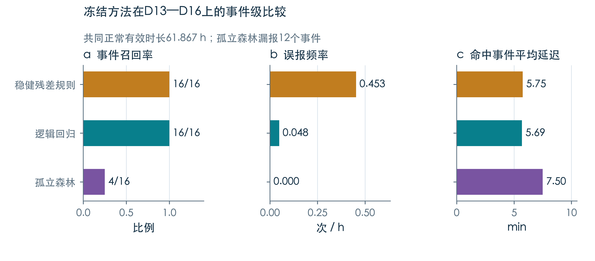

# 第3章 电池异常检测与故障诊断

从因果特征、规则与模型分值，到告警事件、未知状态和补充测量的教学实验。所有数据由程序构造，不包含企业或现场运行记录。数值仅用于解释方法与失效模式。

## 先打开交互演示

下载 [教学演示.html](../../demo/ch03/教学演示.html)，在本地浏览器打开，无需服务器、联网或安装 Python。支持 4 台测试设备、7 种场景、3 种检测方法，调整阈值与连续超阈点数、时间回放、事件区间开关、CSV 与 SVG 导出。GitHub 文件预览不会执行网页，请下载后打开。

推荐先点击两个课堂案例：缺失如何延迟告警；高分为何仍未知。滑块改变告警规则，不在浏览器重新训练。整段指标使用完整180 min，游标下方证据仅对应当前时刻。

## 复现

Python 3.12；依赖沿用仓库根目录 requirements.txt。

```bash
python -m pip install -r requirements.txt
python chapters/ch03/run.py --out chapters/ch03/results/my_run
python chapters/ch03/verify.py
python chapters/ch03/build_demo.py --results chapters/ch03/results/my_run
node --test tests/ch03.test.cjs
```

输出目录必须为空或不存在，避免覆盖旧实验。`models.pkl` 是本地生成的模型，代码会检查重载预测；不要加载来源不明的 pickle 文件。学习路径见 [Notebook](ch03_walkthrough.ipynb)、[课堂讲义](../../docs/ch03课堂讲义.md)。

## 精细绘图

```bash
python -m pip install -r requirements-viz.txt
python chapters/ch03/plot_results.py
python chapters/ch03/draw_diagrams.py
```

定量图输出 PNG（600 dpi）、SVG 和 PDF；原理图输出可编辑 SVG，位置均为 `assets/ch03/`。安装宋体、黑体或 Noto Sans CJK 中文字体。程序绘图使用统一字体、色板、图例与分图间距，数据来自 `reference_results/`，默认不重新拟合模型。若生成新实验，先审查结果再替换参考快照并运行 build_demo.py。



## 冻结实验与结果

固定种子20261114；16台设备100个会话，共18000行。D01—D08训练，D09—D12选择阈值，D13—D16测试；每段180 min，异常区间[60,130)。测试新增组合异常以及与事件重叠的数据缺失。5点尾随窗口只使用当前及过去样本。正常分布仅用训练设备的正常、正常负载突变和缺失场景中完整的窗口拟合，避免把故障结束后的残留窗口混入正常基线。

| 方法 | 阈值 / 连续点数 | 测试事件命中 | 正常时段误报次数 | 误报频率 / 次每小时 | 命中事件平均延迟 / min |
|---|---|---|---|---|---|
| 稳健残差规则 | 4 / 1 | 16/16 | 28 | 0.452586 | 5.7500 |
| 逻辑回归 | 0.70 / 1 | 16/16 | 3 | 0.048491 | 5.6875 |
| 孤立森林 | 0.68 / 5 | 4/16 | 0 | 0 | 7.5000 |

共同正常有效时长61.866667 h。孤立森林在验证集误报预算0.10次/h内的所选参数漏掉全部12个验证事件，不能作为可用检测方案；测试只命中4个新增组合事件，仍漏报12个。这里保留失败结果以说明只看低误报会掩盖检测失效。规则方法测试误报率超过验证阶段预算，说明该预算不构成跨设备保证。逻辑回归结果也只适用于这一构造实验，不能推断现场效果。

事件命中要求新的告警起点位于事件半开区间；事件之前已持续的告警不算命中。缺失退出样本评分和正常有效时长，但异常事件仍保留在漏报分母。平均延迟仅对命中事件计算，必须同时报告漏报。不同方法采用各自的冻结阈值与持续点数。

## 文件说明

- `run.py`：构造观测、设备划分、5点因果特征、训练、验证选阈值、测试、保存及重载。
- `config.json`：全部教学实验控制参数；`requirements.txt`：固定数值依赖。
- `reference_results/`：测试分值、事件清单、事件结果、指标、候选阈值和文件哈希；完整观测与模型由运行生成。
- `verify.py`：42项Python检查，含时间泄漏、缺失恢复、误报暴露时长、事件匹配、训练边界及重载一致性。
- `build_demo.py`、`demo/ch03/`、`tests/ch03.test.cjs`：离线教学演示和8项JavaScript检查，三种方法均与Python全测试集指标逐项核对。
- `plot_results.py`、`visual_style.py`、`draw_diagrams.py`：5幅定量图和2幅原理图源代码。

数据字段、构造依据、限制与权利边界见 [data_dictionary.md](data_dictionary.md)、[data_sources.md](data_sources.md)、[RIGHTS.md](../../RIGHTS.md)。本章代码与图表可公开查看；具体再许可范围以权利声明为准。
