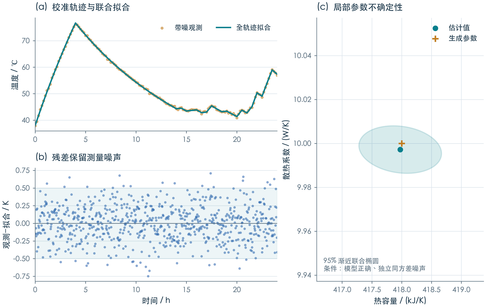

# 第4章 储热动态辨识与状态估计

本章用充分混合、无进出水的 W-H1 水罐完成机理参数辨识、功率残差学习、KF/EKF状态估计和独立工况验证。**数据来源：本章明示方程生成的教学轨迹。现场应用需另行开展独立实验。**

[离线教学演示](../../demo/ch04/教学演示.html) · [Notebook](ch04_walkthrough.ipynb) · [课堂操作](../../docs/ch04/课堂讲义.md) · [模型卡](model_card.md) · [参考结果](../../docs/ch04/reference_summary.json)



## 最小运行

在仓库根目录，使用 Python 3.12：

```bash
python -m pip install -r requirements.txt
python chapters/ch04/run.py --out results/ch04
python chapters/ch04/verify.py
python chapters/ch04/build_demo.py --source results/ch04/experiment.json
node --test tests/ch04.test.cjs
```

第四章 `--out` 相对路径以**当前工作目录**为基准；非空目录拒绝覆盖。默认输出路径为仓库的 `results/ch04`。与第二章的旧接口约定不同，请按各章命令运行。

Windows PowerShell可用 `py -3.12 -m venv .venv` 创建环境，再用 `.venv\Scripts\python.exe` 替换上述 `python`。全部计算使用CPU，无外部API，无密钥。固定依赖沿用根目录 requirements.txt。

## 精细重绘

```bash
python -m pip install -r requirements-viz.txt
python chapters/ch04/plot_results.py
python chapters/ch04/draw_diagrams.py
```

五幅定量图、两幅原理图均输出600 dpi PNG、保留文本的SVG和PDF。Linux安装 `fonts-noto-cjk`；macOS使用系统中文字体；Windows可使用微软雅黑。也可给两个绘图脚本传 `--font /path/to/font`。字体不随仓库分发。

## 离线教学

下载仓库后双击 `demo/ch04/教学演示.html`。GitHub文件预览不会执行HTML。演示可调C、UA、噪声、偏移和Q，可切换四种独立测试工况，逐步回放更新并导出CSV、SVG。浏览器计算与Python的八组“工况×模型”误差和能量指标由Node测试逐一核对。

## 实验配置与结果

配置集中在 `run.py` 的常量与 `build_data()`：C=418 kJ/K、UA=0.010 kW/K、Δt=120 s、测量噪声标准差0.25 K。十条轨迹180 h、5410行温度记录；其中配对偏移测试与附加散热测试共享物理轨迹和噪声，统计时作为共享物理过程的配对对照登记。

机理校准2×24 h；残差训练2×18 h；模型选择12 h+18 h；独立测试12 h+3×18 h。校准C/UA时联合估计每条初温。残差β在独立开发轨迹上拟合；Q只按选择轨迹的创新似然选择。最终评分从20 min起；能量偏差使用完整开环轨迹。

| 工况 | 机理开环RMSE/K | 灰箱开环RMSE/K | KF RMSE/K | EKF RMSE/K |
|---|---:|---:|---:|---:|
| 常规 | 0.146 | 3.654 | 0.017 | 3.231 |
| 附加散热 | 5.281 | 0.100 | 2.082 | 0.010 |
| 传感器偏移 | 5.281 | 0.100 | 2.712 | 0.084 |
| 高温外推 | 12.205 | 0.564 | 3.878 | 0.358 |

这些结果的适用范围由指定构造机制限定；现场泛化性能需通过独立实测评估。附加散热工况的EKF内部95%区间实际轨迹覆盖率为80.0%，偏移测试为33.7%；低RMSE描述估计误差，区间校准程度由覆盖情况另行评估。Q=0是本次确定性选择结果；现场配置需结合实际扰动重新确定。

## 文件与可复用接口

- `linear_step`：零阶保持的解析线性推进，含UA=0极限。
- `reference`：DOP853温度与参考热量积分，独立于部署积分器。
- `fit_physical`：只用输入、环境、观测拟合物理参数。
- `fit_residual`：冻结物理参数，拟合一个有单位的功率残差系数。
- `filter_episode`：因果KF/EKF，Joseph方差更新，初始观测不重复校正。
- `verify.py`：35项数值、信息边界与失败工况检查。
- `data_dictionary.md`：时间对齐、空字段、单位和来源。

复现输出包括 `summary.json`、`experiment.json`、`trajectories.csv` 与 `manifest.json`；结果目录不提交到仓库。完整参考摘要已登记在 docs/ch04，冻结演示数据位于 demo/ch04/data.js。

版本：第4章教学版 v0.1.0，2026-11-14。引用建议：石玉琦，储能系统人工智能实践第4章配套教学代码，v0.1.0，2026，附本仓库URL及实际提交SHA。尚未正式出版，不设置虚构DOI。许可沿用根目录 [RIGHTS.md](../../RIGHTS.md)，本次未新增开源授权。
