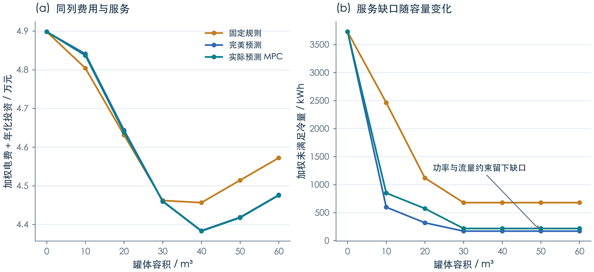

# 第5章 储冷容量配置与滚动控制

教学版本 v0.1.0，2026-11-14。作者：石玉琦。本章从W-C1的水侧冷量边界出发，比较容量、温度资格、规则策略、完美预测与实际预测MPC。全部负荷、天气、电价和投资参数由代码构造，用于学习与复算。

[离线教学演示](../../demo/ch05/教学演示.html) · [逐步Notebook](ch05_walkthrough.ipynb) · [课堂讲义](../../docs/ch05/课堂讲义.md) · [字段字典](data_dictionary.md) · [模型卡与来源](model_card.md)



## 先体验

下载仓库ZIP并解压，双击 `demo/ch05/教学演示.html`。单文件内含113组Python求解结果、脚本与样式，可离线使用。网页提供五类工况、七个容积、三种策略，以及固定热浪日20 m³下的三种时域和三种预测偏差。支持播放、库存与预测计划对照、CSV及SVG导出。浏览器执行预计算方案的选择与回放；改变模型参数后需重新运行Python生成方案库。

## 安装与完整复现

建议Python 3.12与Node.js 24，在仓库根目录运行。macOS/Linux先执行 `python3.12 -m venv .venv` 和 `source .venv/bin/activate`；Windows PowerShell执行 `py -3.12 -m venv .venv` 和 `.venv\Scripts\Activate.ps1`。

```sh
python -m pip install -r requirements.txt
python -m pip install -r requirements-viz.txt
python chapters/ch05/run.py --out results/ch05
python chapters/ch05/verify.py
python chapters/ch05/plot_results.py
python chapters/ch05/draw_diagrams.py
python chapters/ch05/build_demo.py
node --test tests/ch05.test.cjs
```

安装依赖需要网络，实验计算使用CPU。`run.py --out`相对路径以当前工作目录为准；输出目录须为空。重新实验请用新目录，再以绘图与演示脚本的 `--source 新目录/experiment.json` 指定结果。原理图使用显式模型边界，不读取实验结果。Linux绘图建议安装 `fonts-noto-cjk`；两个绘图脚本均支持 `--font 字体文件`。仓库不分发字体。

Notebook额外需要 `python -m pip install notebook ipython`。在仓库目录或其子目录启动Jupyter并逐格执行，笔记自动寻找仓库根目录，使用新的临时结果目录。已保存五个代码单元的实际执行输出和绘图。

## 输出与检查

| 文件或目录 | 内容 |
| --- | --- |
| `run.py` | 数据构造、岭回归冻结、MILP、规则与滚动执行、年化核算 |
| `verify.py` | 76项数值检查，含113条轨迹的1695项条件判断 |
| `plot_results.py` | 六幅定量图，SVG、PDF、600 dpi PNG |
| `draw_diagrams.py` | 两幅精细原理图，同样三种格式 |
| `build_demo.py` | 从同一份结果生成离线方案库与单文件HTML |
| `results/ch05/experiment.json` | 输入、配置、训练参数、113条轨迹及滚动计划 |
| `results/ch05/summary.json` | 指标、年度汇总及求解日志 |
| `results/ch05/dispatch.csv` | 2712条逐时执行记录 |
| `results/ch05/manifest.json` | 三个输出文件的SHA-256 |
| `../../docs/ch05/reference_summary.json` | 本次基准汇总，用于核对量级与指标 |

求解器必须返回最优状态；程序同时保存目标、对偶界与间隙。核验涵盖手算、小型枚举、未来信息隔离、不可行工况、能量账、流量、温度、容量、互斥与加权汇总，并检验人为破坏库存记录后能否发现错误。网页数值另由Node.js独立复算。不同平台在多重最优解下可能产生略有区别的功率分配，比较时先检查可行性、目标与服务指标。

## 可复算的主要现象

- 正常20 m³有效容量118.433 kWh；40 m³为236.867 kWh。
- 炎热日20 m³：固定规则电费150.65元、未满足冷量7.58 kWh；完美预测152.27元、0 kWh；MPC 151.65元、2.82 kWh。目标值按电费加100元/kWh冷量的服务权重比较。
- 热浪日20 m³：6 h时域未满足冷量88.40 kWh，24 h时域无附加偏差时64.03 kWh。零末端库存条件随时域一起记录。
- 四类日按150/120/90/5日加权，MPC在本次离散候选与投资假设下的最低费用为40 m³、43829.20元，同时保留218.17 kWh未满足冷量。
- 60 m³完美预测热浪日仍有34.21 kWh缺口，其中25.55 kWh是管路上限给出的最低缺口，其余与补冷机会及库存耗尽有关。

服务条件与费用分别报告。投资函数8000+600V元、5%利率及15年期限均为教学假设；项目应用需用实际设备、负荷、价格和服务要求重新评价。

## 来源与使用

本代码对应写作中的教材章节，建议引用：“石玉琦，储能系统人工智能实践，第5章配套教学代码，v0.1.0，2026”，附仓库URL与使用的提交SHA。权利说明沿用仓库 [RIGHTS.md](../../RIGHTS.md)。图5.1为书稿中的AI教学场景，公开仓库提供八幅代码图及其源代码。方法参考见 [模型卡](model_card.md)。
