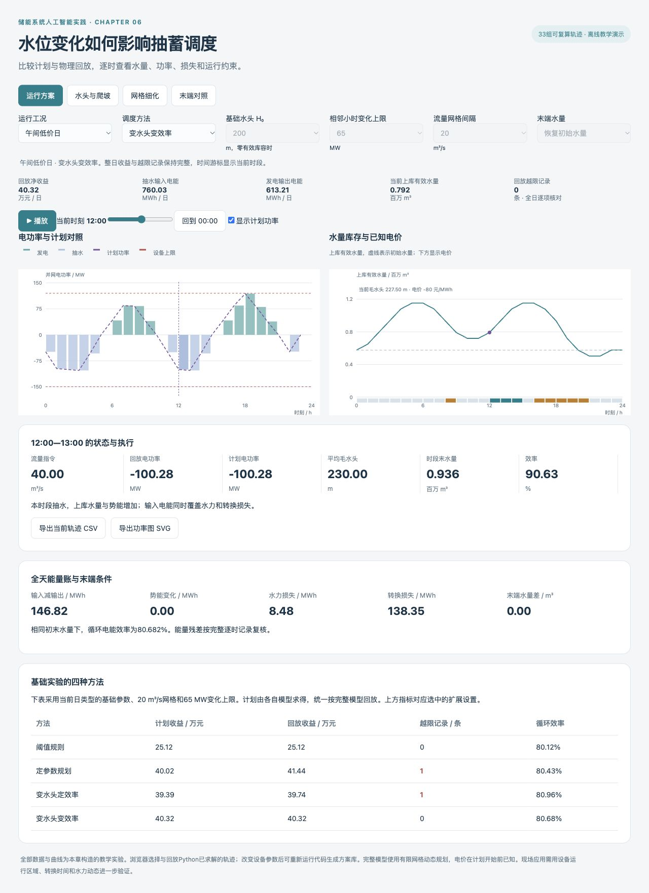
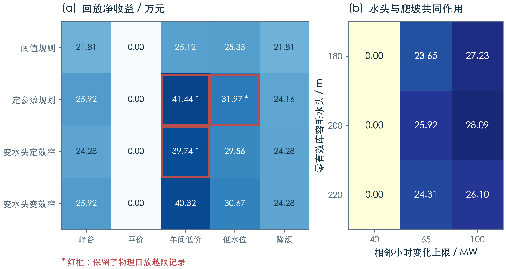

# 第6章 机械储能运行优化

以闭式双水库抽蓄为教学对象，把水量、水头、效率、电功率、模式转换和调度收益连接起来。全部价格、参数与效率曲线为构造数据，代码版本0.1.0，审校日期2026-11-14。压缩空气部分提供状态迁移设计，数值调度实验集中于抽水蓄能。

[离线演示](../../demo/ch06/教学演示.html) · [逐步Notebook](ch06_walkthrough.ipynb) · [课堂讲义](../../docs/ch06/课堂讲义.md) · [模型说明](../../docs/ch06/模型说明.md) · [数据字典](../../docs/ch06/数据字典.md)



## 立即体验

下载仓库ZIP并解压，双击 `demo/ch06/教学演示.html`。文件内置33条已求解轨迹、脚本与样式，可离线运行。GitHub文件预览只展示源码，下载后用浏览器打开即可交互。

- 运行方案：五类工况、四种方法，比较计划与完整物理回放。
- 水头与爬坡：三种基础水头、三种相邻小时功率变化上限。
- 网格细化：20/10/5 m³/s网格与40/65 MW变化上限。
- 末端对照：恢复初始水量或放开末端水量，分别读取循环效率与库存释放。

逐时播放、暂停、滑块定位、CSV及可编辑SVG导出均在本地完成。浏览器选择Python已求解的轨迹；新增参数组合后需重新运行Python并构建数据文件。

## 安装与复现

推荐Python 3.12和Node.js 24。macOS/Linux在仓库根目录：

```sh
python3.12 -m venv .venv
source .venv/bin/activate
python -m pip install -r requirements-viz.txt
python chapters/ch06/run.py --out results/ch06
python chapters/ch06/verify.py
python chapters/ch06/plot_results.py
python chapters/ch06/draw_diagrams.py
python chapters/ch06/build_demo.py
node --test tests/ch06.test.cjs
```

Windows PowerShell使用 `py -3.12 -m venv .venv` 创建环境，再以 `.venv\Scripts\python.exe` 替换上述 `python`。首次安装依赖需要网络。核心计算仅需 `requirements.txt`，绘图增加 `requirements-viz.txt`；Notebook还需安装 `jupyter`、`ipython`、`nbformat`。Linux绘图可安装 `fonts-noto-cjk`，或向两个绘图脚本传入 `--font 字体文件路径`。字体不随项目分发。

`--out`的相对路径以执行时的工作目录为准；默认目录基于仓库根目录。程序保留已有结果，非空输出目录会被拒绝。重复实验可用 `--out results/ch06_trial2`，然后向 `plot_results.py` 与 `build_demo.py` 传入 `--source results/ch06_trial2/experiment.json`。`verify.py`独立重算默认实验，执行61项检查；其中逐轨迹审计覆盖33×17=561项条件。网页执行9项测试。

## 可复算结果

共33条24小时轨迹、792条逐时记录，另保留1个目标不可达案例。四种方法均把原流量序列送入同一个完整模型回放，越限时保留原记录。

| 对照 | 实际回放结果 | 教学意义 |
| --- | --- | --- |
| 峰谷日，定参数/完整模型 | 相同流量序列，收益均25.91855万元 | 模型细节的收益影响取决于其他约束 |
| 午间低价日，定参数 | 收益41.44133万元，13时抽水155.0354 MW | 同时读取收益与150 MW功率边界 |
| 午间低价日，完整模型 | 收益40.32446万元，0条越限 | 在本章有限网格可行集中比较 |
| 40 MW变化上限，20/10/5流量网格 | 收益0/19.09421/22.58955万元 | 小动作增加启动路径 |
| 放开末端水量 | 收益45.41844万元，势能减少329.616 MWh | 库存释放进入能量账，循环效率留空 |



## 文件与来源

`run.py`建立有限状态图并求解、回放和导出；`verify.py`通过独立公式和2401条小问题枚举路径检验实现；`plot_results.py`重绘5幅定量图；`draw_diagrams.py`重绘3幅原理图；`visual_style.py`统一字体和样式；`build_demo.py`连接结果与网页。图稿提供SVG/PDF及600 dpi PNG。

输出 `experiment.json`保存完整参数、状态、计划、回放和失败案例；`summary.json`保存摘要；`dispatch.csv`保存逐时记录；`manifest.json`记录三个结果文件的SHA-256。紧凑网页数据保留7位小数，数值核验使用原始精度。

概念来源及适用范围见模型说明；原始数据完全由公开代码生成。引用本教学资产时请注明“石玉琦，《储能系统人工智能实践》第6章配套代码，版本0.1.0，2026”，附仓库地址与实际使用的commit SHA。全书正文及AI场景图独立保存；本目录的使用条件遵循仓库根目录RIGHTS说明。
