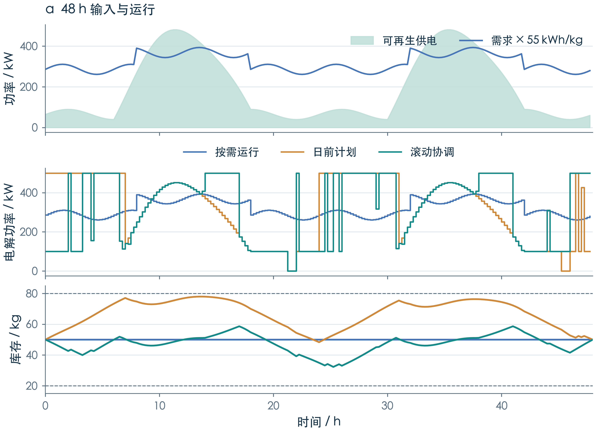

# 第8章 制储用氢系统协同运行

质量库存连接电解、压缩和外部用氢需求。比较按需运行、48 h日前计划和6 h滚动协调；36组主实验加3组边界对照，全部采用作者构造的数据。

[离线交互演示](../../demo/ch08/教学演示.html) · [已执行Notebook](ch08_walkthrough.ipynb) · [模型卡](model_card.md) · [数据字典](data_dictionary.md) · [课堂讲义](teaching_handout.md)



## 运行

在仓库根目录执行（Python 3.12，Node.js 24用于跨语言检查）：

```sh
python -m pip install -r requirements.txt
python -m pip install -r requirements-viz.txt
python chapters/ch08/run.py
python chapters/ch08/verify.py
python chapters/ch08/plot_results.py
python chapters/ch08/draw_diagrams.py
python chapters/ch08/build_demo.py
node --test tests/ch08.test.cjs
```

Linux绘图需 `fonts-noto-cjk`；macOS自动使用系统中文字体，Windows可用微软雅黑。也可向两个绘图脚本传入 `--font 字体文件路径`。字体由使用者合法取得，仓库保留字体名称而不分发字体文件。

Windows PowerShell可先运行 `py -3.12 -m venv .venv`，再用 `.venv\Scripts\python.exe` 替代命令中的 `python`。文件读写显式采用UTF-8。运行脚本重新生成 `results/ch08` 下的教学结果；正式修改实验前可将原结果保存到其他目录。`run.py --out 路径`仅改变该次实验输出位置，其余脚本默认读取 `results/ch08`。

## 课堂体验

下载仓库ZIP并解压，双击 `demo/ch08/教学演示.html`。页面包含所有数据和脚本，可离线使用。情景、容量与策略选项切换36组预计算结果，时间滑块/播放展示15 min区间账本；温度和Z只改变压力诊断。CSV导出选中方案的192行记录，SVG导出三策略库存图。修改调度参数后需要在Python中重新求解并运行build_demo.py。

## 结果与适用条件

80 kg配置、库存初值50 kg。基准情景三种策略均供应279.60 kg氢且期末50.00 kg：

|策略|购电费用/元|缺供/kg|弃能/kWh|
|---|---:|---:|---:|
|按需|4965.72|0.00|579.01|
|日前|2802.73|0.00|63.30|
|滚动|3506.09|0.00|48.17|

需求突增下，日前计划缺供4.34 kg，滚动协调为0。突发供能受限下，按需、日前、滚动缺供分别为28.98、42.02、38.24 kg；事前库存与预测视野共同影响服务。完整结果见 [参考汇总](reference_results/summary.csv)。

容量扫描同时改变库存上限40/80/120 kg、初始库存30/50/70 kg和容积2.5/5/7.5 m³。分别固定容量或初值的实验可以进一步隔离各因素作用。压力为给定温度、容积和Z的换算；模型的15 min平均流与常效率用于调度教学，设备动态、物性和现场数据可继续接入。

## 可复用文件

- `model.py`：配置、合成输入、质量执行器、MILP、因果预测和指标。
- `run.py`：36组主实验、辅机/期末/时间步长3组对照、分组检查点。
- `verify.py`：52540项独立账本与边界检查、两步解析最优解、不可行负例、未来观测隔离。
- `plot_results.py`、`draw_diagrams.py`：8幅代码彩图，SVG/PDF/600 dpi PNG。
- `demo_core.js`、`demo_template.html`、`build_demo.py`：离线交互与Python执行器的JavaScript对应实现。
- `config.json`：默认配置快照；实际参数入口为 `Config` / `config()`，Notebook演示使用dataclasses.replace进行显式变更。
- `reference_results`：本版摘要与验证证据；完整原始结果由run.py重建。

版本：chapter-08-v1，2026-11-14。新增代码、原创代码绘图和合成数据沿用仓库MIT许可；外部文献仅提供来源链接。推荐引用：石玉琦. 储能系统人工智能实践：第8章制储用氢系统协同运行配套代码. 2026. https://github.com/syq-cmdi/ai-energy-storage-practice （使用时补充实际commit）。
